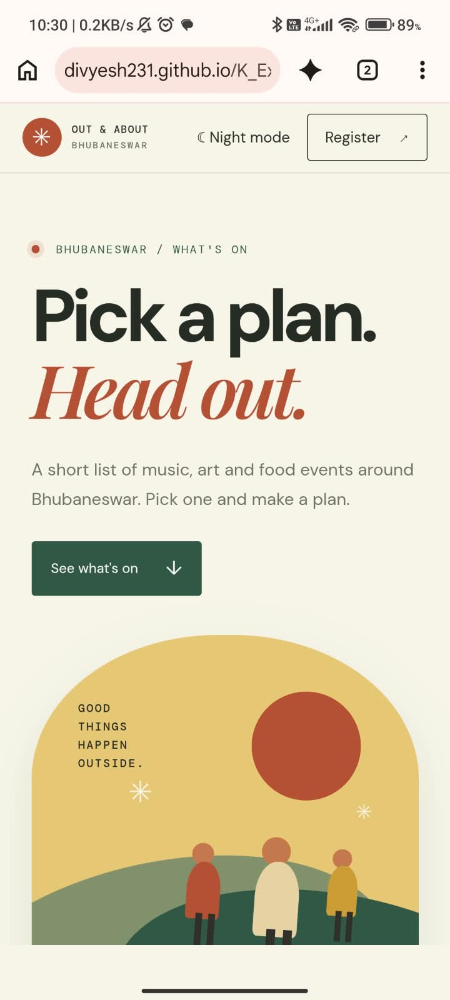
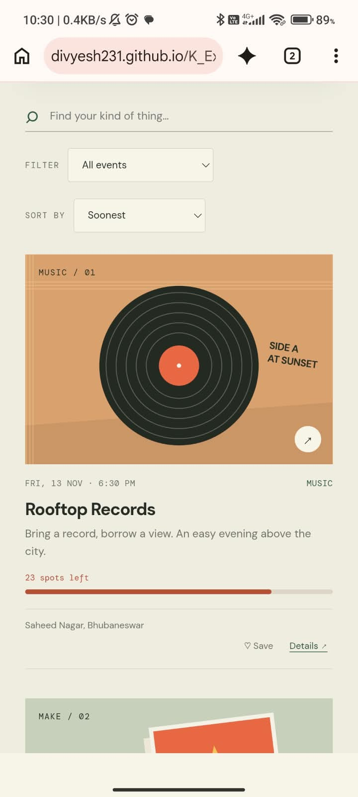

# Events in Bhubaneswar

This is a small event guide website I built for a web design project. It brings together sample music, art and food events in Bhubaneswar so visitors can browse ideas, save the ones they like and make a plan.

The events are made-up examples for the project. They are not real listings, and signing up on the page does not contact an organiser.

## Screenshots

These show the home page and event list on desktop and Android.

### Desktop


### Mobile





## Design choices

I used a warm paper background with forest green, terracotta and yellow accents to match the handmade event posters. On desktop, the search, filter and sort controls sit in one row; on smaller screens they stack to make them easier to use.

## Project structure

```text
Web_Designing/
├── index.html
├── styles.css
├── script.js
├── README.md
├── .gitignore
├── screenshots/
│   ├── android1.jpeg
│   ├── android2.jpeg
│   ├── android3.jpeg
│   ├── android4.jpeg
│   ├── Screenshot 2026-11-05 102856.png
│   ├── Screenshot 2026-11-05 102914.png
│   ├── Screenshot 2026-11-05 102923.png
│   └── Screenshot 2026-11-05 102935.png
└── assets/
    ├── poster-chai.svg
    ├── poster-open-mic.svg
    ├── poster-patch.svg
    ├── poster-records.svg
    ├── poster-supper.svg
    └── poster-zine.svg
```

### What the files do

- **`index.html`** contains the page layout, event information, registration form and details dialog.
- **`styles.css`** controls the colors, typography, poster cards, responsive layout, dark theme and small animations.
- **`script.js`** handles the countdown, search, filters and sorting, sample availability, favorites, event sharing, calendar downloads, form validation and theme preference.
- **`assets/`** contains the SVG posters used on the event cards.
- **`screenshots/`** contains desktop and Android captures of the site.
- **`README.md`** is this project guide.

## Features

- Browse six sample events with custom poster artwork.
- See a filled-capacity bar and remaining spot count on each event.
- Watch the local spot count decrease after a sign-up and return when you remove that plan.
- Search by event name or details, then use one compact filter menu for categories, coming-soon events, almost-full events or saved events.
- Sort the list by date, name or spots left.
- Save favorite events and switch to a list of saved events.
- See a countdown to the next event in the sample schedule.
- Open an event’s details, share a link to it, or download a calendar file.
- Use the registration form and view saved plans on the page.
- Switch between light and dark mode.
- Use the page on desktop or mobile, with keyboard focus styles and a skip link.

## How to run it

There is no install step or build command.

1. Download the repository and unzip it, or open the project folder on your computer.
2. Open **`index.html`** in a web browser.

Keep `styles.css`, `script.js` and the `assets` folder beside `index.html` so the page can load its styles, features and posters.

## Publishing with GitHub Pages

This is a static site, so it can be published directly from the repository:

1. Open the repository on GitHub and go to **Settings → Pages**.
2. Under **Build and deployment**, choose **Deploy from a branch**.
3. Select the `main` branch and the `/ (root)` folder, then click **Save**.
4. Wait for GitHub Pages to finish, then open the site link shown on the Pages settings screen.

For this repository, the Pages address should be `https://divyesh231.github.io/K_Explore_WebDesign/` once publishing is enabled. No custom domain is needed.

## A few notes

Favorites, sample registrations and the theme preference are stored in the browser with `localStorage`. They do not sync to another device or go to a server. The registration form is a front-end demonstration only.

The countdown and calendar downloads use the dates in the sample listings. Starting capacity is made up, and sign-ups only adjust the spot count in the current browser; it is not shared booking data. Calendar files assume an event lasts two hours. If you change an event’s date, update its date in both `index.html` and `script.js` so the card, countdown and calendar stay in sync.
